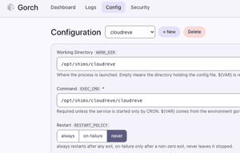

# gorch

轻量级进程管理工具，使用 Odin 编写，灵感来自 [Sysg](https://github.com/ra0x3/systemg) 和 [Supervisor](http://supervisord.org/)。

单二进制文件，无运行时依赖。声明式 TOML 配置。内置 Web 管理界面。

[English](./README.md)



## 为什么选择 gorch？

- **Web 界面 + REST API** — 通过浏览器仪表盘管理服务，或用简洁的 JSON API 写脚本自动化。Odin 版去掉了 Go 版的 CLI 子命令，安装为系统服务改由两个 shell 脚本负责。
- **Web 登录支持 TOTP 两阶段认证** — 账号密码直接写在配置文件里，但有了 TOTP 二阶段认证，就算密码泄露了也不怕。
- **单二进制、零依赖** — 一个文件，放哪儿都能跑。
- **优雅重载支持** — 对于 Nginx/Angie 这类守护进程，`RESTART_CMD` 让主进程 PID 保持稳定，只重启 worker。

## 不适用场景

gorch 非常适合 Web 应用、API 服务、定时任务、无状态守护进程。但**不建议**用于：

- **传统大型数据库**（MySQL、PostgreSQL 等）— 频繁重启可能导致数据不一致甚至损坏数据库。请使用数据库自带的管理工具。

## 二进制文件

本仓库只构建一个二进制文件：**`gorch`** — 进程管理工具，管理常驻服务与定时任务，内置 Web 界面和 REST API。

由 Odin 编写。Web 界面压缩后嵌入二进制，部署只需一个文件；配置旁若存在 `web/` 目录，则按文件优先于内嵌副本。

> **Odin 二进制没有任何子命令**：没有 `install`、`uninstall`，也没有 `start`、
> `stop`、`restart`、`status`、`logs`。安装 / 卸载系统服务由两个 shell 脚本完成，
> 管理被托管的服务走 Web 界面或 REST API。上述子命令只存在于 `lite` 分支的 Go 版实现。

## 安装

### 1. 构建二进制

**构建机**需要 [Odin](https://odin-lang.org/) `dev-2026-10` 或更新版本；目标机无需任何依赖（Linux 为静态 musl 链接，macOS 要求 11 及以上）。

```sh
git clone https://github.com/azhai/gorch.git
cd gorch
git checkout v0.4.4      # 换成你要部署的 tag
make deps                # 拉取唯一子模块 vendor/oboe
make one                 # 构建本机版本 ./bin/gorch
```

构建 macOS / Linux × arm64 / amd64 的发布产物：

```sh
make build                                   # 四个目标 + bin/SHA256SUMS
make build TARGETS="linux_arm64"             # 单个目标
make build CROSS_CC="x86_64-linux-musl-gcc"  # 覆盖交叉链接器（默认 zig cc）
make release                                 # build + 用 upx --brute 压缩 Linux 产物
```

完整矩阵应在 macOS 上构建：darwin 目标原生链接，linux 目标用 `zig cc` + 静态 musl 交叉链接，并带上 `third_party/zlib` 的精简 zlib 源码；本机构建直接用系统 zlib。在 Linux 主机上只构建 `linux_*` 目标。安装了 `upx` 时，`make release` 还会在普通二进制旁生成 `gorch-<版本>-linux-<架构>.upx`，UPX 在加载时透明解压，可直接替换使用。GitHub 的 tag 只附源码压缩包，二进制由上述 `make` 目标生成（或直接复用已构建好的 `bin/` 产物）。

### 2. 部署二进制

目标机上只需要这一个文件：无运行时、无动态库、也不需要 `web/` 目录。先校验校验和（在 `bin/` 下执行，或把 `SHA256SUMS` 与产物放在一起），再以 `gorch` 这个普通名字安装，方便服务脚本自动查找：

```sh
sha256sum -c SHA256SUMS --ignore-missing   # Linux；macOS 用：shasum -a 256 gorch-v0.4.4-darwin-arm64
chmod +x gorch-v0.4.4-linux-amd64
sudo install -m 755 gorch-v0.4.4-linux-amd64 /usr/local/bin/gorch
gorch --help
```

想用更小的体积，把文件名换成 `gorch-v0.4.4-linux-amd64.upx` 即可。二进制放在别处时，用 `gorch-install --bin PATH` 或环境变量 `GORCH_BIN` 指定。

### 3. 安装为系统服务

二进制本身是前台运行的，长驻和崩溃拉起交给服务管理器。两个独立的 POSIX `sh` 脚本负责生成 systemd unit（Linux）或 launchd plist（macOS）：

```sh
sudo ./scripts/gorch-install --config /etc/gorch/gorch.toml          # 系统级，需要 root
./scripts/gorch-install --user --config ~/.config/gorch/gorch.toml   # 用户级，无需 root
./scripts/gorch-install --dry-run --config /etc/gorch/gorch.toml      # 只预览，不写任何文件
```

| 参数 | `gorch-install` | `gorch-uninstall` |
|------|:---------------:|:----------------:|
| `-c, --config PATH` | 指定配置文件 | — |
| `-b, --bin PATH` | 指定二进制 | — |
| `-u, --user` | 用户级服务 | 用户级服务 |
| `-n, --no-start` | 只写服务文件，不启用/启动 | — |
| `-d, --dry-run` | 只预览，不做修改 | 只预览，不做修改 |
| `-h, --help` | 显示帮助 | 显示帮助 |

配置文件查找顺序：`--config`、`$GORCH_CONFIG`、`/etc/gorch/gorch.toml`、`~/.config/gorch/gorch.toml`、`./gorch.toml`（加 `--user` 时家目录路径优先）。二进制查找顺序：`--bin`、`$GORCH_BIN`、`./bin/gorch`、`./gorch`、`$PATH`。

| 系统 | 范围 | 服务文件 |
|------|------|----------|
| Linux | 系统级 | `/etc/systemd/system/gorch.service` |
| Linux | `--user` | `~/.config/systemd/user/gorch.service` |
| macOS | 系统级 | `/Library/LaunchDaemons/com.github.azhai.gorch.plist` |
| macOS | `--user` | `~/Library/LaunchAgents/com.github.azhai.gorch.plist` |

生成的服务执行的是 `gorch -c <配置>`：systemd 下为 `Type=simple` + `Restart=on-failure`，launchd 下为 `KeepAlive` + `RunAtLoad`。**没有 `start` 子命令，也没有 `PIDFile`**——Odin 二进制不 fork。脚本随后执行 `systemctl daemon-reload && systemctl enable --now gorch.service`（macOS 为 `launchctl load -w <plist>`）；用了 `--no-start` 时可手工执行这些命令。systemd 用户级服务默认会在注销后停止，需要常驻请再执行 `loginctl enable-linger <用户名>`。全部参数与生成文件见[命令参考](./docs/cli-ZH.md)。macOS 下也可用 [launchd-ui](https://github.com/azu/launchd-ui) 管理生成的 agent。

## 使用

### 1. 创建配置文件

```sh
sudo mkdir -p /etc/gorch
sudo cp gorch.toml.example /etc/gorch/gorch.toml
```

最简配置：

```toml
[services.myapp]
EXEC_CMD = "python app.py"
```

生产环境示例：

```toml
LOG_DIR = '/tmp/gorch/logs'

[web]
WEB_ENABLE = true
WEB_AUTH = true
WEB_USER = "admin"
WEB_PASS = "secret"

[services.api]
EXEC_CMD = "python manage.py runserver 0.0.0.0:8000"
WORK_DIR = "/app/backend"
RESTART_POLICY = "on-failure"
BACK_OFF = 5
CHECK_PORT = 8000
STDOUT = "/tmp/gorch/logs/api.stdout.log"
STDERR = "/tmp/gorch/logs/api.stderr.log"
DEPENDS_ON = ["redis"]

[services.redis]
EXEC_CMD = "redis-server /etc/redis/redis.conf"
RESTART_POLICY = "always"
BACK_OFF = 3
```

### 2. 启动 gorch

```sh
gorch                             # 前台运行，自动查找配置
gorch -c /etc/gorch/gorch.toml    # 显式指定配置
gorch --config=/etc/gorch/gorch.toml
gorch --help
gorch --version
```

| 参数 | 默认值 | 说明 |
|------|--------|------|
| `-c, --config <路径>` | 自动查找 | 配置文件路径 |
| `-h, --help` | | 打印用法并退出 |
| `-v, --version` | | 打印版本并退出 |

未指定 `-c` 时，按 `$GORCH_CONFIG` → `./gorch.toml` → `~/.config/gorch/gorch.toml` → `/etc/gorch/gorch.toml` 取第一个存在的文件；都不存在则报错退出。`GORCH_WEB_DIR` 可覆盖 SPA 静态资源目录（二进制内已内嵌一份副本）。

**没有守护进程参数**（`-d`）：gorch 一直前台运行，收到 `SIGTERM`/`SIGINT` 时先停掉所有子进程再退出。需要后台常驻请按上文安装为系统服务。

> 提示：`--version` 目前打印的是固定字符串，不是 `git describe` 出的发布版本号；
> 判断二进制是否为目标产物请用 `SHA256SUMS` 校验。

### 3. 管理 gorch 自身

装成服务后，用服务管理器操作，而不是 gorch 子命令：

```sh
# Linux / systemd（用户级安装请加 --user）
sudo systemctl status gorch.service
sudo systemctl restart gorch.service
sudo systemctl stop gorch.service        # 同时停掉所有被托管的服务
sudo journalctl -u gorch.service -f

# macOS / launchd
sudo launchctl list com.github.azhai.gorch
sudo launchctl unload -w /Library/LaunchDaemons/com.github.azhai.gorch.plist
sudo launchctl load -w /Library/LaunchDaemons/com.github.azhai.gorch.plist
```

systemd 下 gorch 自身输出进 journal；launchd 下写到 `/tmp/gorch/logs/gorch.{out,err}.log`。

### 4. 管理被托管的服务

用仪表盘上的 启动 / 停止 / 重启 按钮，或调用同样的 REST API：

```sh
curl -u admin:secret http://127.0.0.1:8080/api/services
curl -u admin:secret -X POST http://127.0.0.1:8080/api/services/api/restart
curl -u admin:secret -X POST http://127.0.0.1:8080/api/services/api/stop
```

只有 `WEB_AUTH = true` 时才需要 `-u` 账号密码。配置了 `URL_PREFIX = "/gorch"`（例如反代到 `https://host/gorch/`）时，所有 UI 与 API 路径都要加前缀：`/gorch/api/services`。

### 5. 查看日志

Web 界面提供实时的 stdout / stderr 日志查看器；API 返回 JSON 格式的尾部内容：

```sh
curl -u admin:secret 'http://127.0.0.1:8080/api/services/api/logs?type=stderr&lines=100'
```

### 6. Web 管理界面

当 `WEB_ENABLE = true` 时，浏览器打开 `http://127.0.0.1:8080`（默认 `WEB_ADDR`；子目录部署需设置 `URL_PREFIX`）。

功能：
- 仪表盘：实时状态展示（含每个服务的 RSS 物理内存）
- 日志查看器：stdout / stderr 切换
- 配置编辑器：两步保存（应用到内存 → 持久化到文件）
- Cron 表达式验证

## 卸载

卸载就是移除 systemd unit / launchd plist。脚本会先停止并禁用服务，**只删除服务文件**：

```sh
sudo ./scripts/gorch-uninstall        # 系统级
./scripts/gorch-uninstall --user     # 用户级
./scripts/gorch-uninstall --dry-run  # 只预览将执行的动作
```

二进制、配置、日志和状态文件都会有意保留，因此升级只需替换二进制再跑一次 `gorch-install`。如需彻底清理，请先停止服务，再自行删除以下文件：

| 路径 | 内容 |
|------|------|
| `/usr/local/bin/gorch`（或 `--bin` 指定的路径） | 二进制 |
| `/etc/gorch/gorch.toml`、`~/.config/gorch/gorch.toml` | 配置（含 Web 账号密码） |
| `<LOG_DIR>`，默认 `/tmp/gorch/logs` | 各服务的 stdout / stderr 日志 |
| `/tmp/gorch/gorch.state`、`<LOG_DIR>/gorch.state` | 服务状态快照 |
| `TOTP_DB`，默认 `/var/lib/gorch/totp.db` | TOTP 绑定数据库 |

若曾为 systemd 用户级服务开启 lingering，还需执行 `loginctl disable-linger <用户名>`。手工 `systemctl` / `launchctl` 命令见[命令参考](./docs/cli-ZH.md)。

## 运行时文件

gorch 启动时会创建 `/tmp/gorch` 及其 `logs/` 子目录。除非用 `LOG_DIR` 指向别处，
它写入的文件都在这里：

| 路径 | 用途 |
|------|------|
| `<LOG_DIR>/<名称>.out.log` | 服务标准输出（未设置 `STDOUT` 时的默认值） |
| `<LOG_DIR>/<名称>.err.log` | 服务标准错误（未设置 `STDERR` 时的默认值） |
| `<LOG_DIR>/gorch.state` | 服务状态的原子快照（oboe cache） |

`LOG_DIR` 默认为 `/tmp/gorch/logs`；未设置 `LOG_DIR` 时状态文件为
`/tmp/gorch/gorch.state`。`STDOUT` / `STDERR` 可覆盖单个服务的日志路径。
启用 TOTP 时 `TOTP_DB` 默认为 `/var/lib/gorch/totp.db`。

Odin 版没有 Unix socket、supervisor PID 文件，也没有 CLI 与 supervisor 的 IPC——
服务控制走 Web 界面和 REST API。全局 `PID_FILE`、`SERVICES_LOCK` 两个键仍会被
接受（兼容旧配置），但不再使用。

> **注意：** `/tmp` 在系统重启后会被清空（macOS 还会定期清理），因此日志不会保留。如需长期保存，请把 `LOG_DIR` 指向持久化目录。

## 文档

- [配置说明](./docs/configuration-ZH.md) — 所有配置字段、cron 表达式、环境变量、服务配置示例
- [命令参考](./docs/cli-ZH.md) — 二进制参数、服务脚本、REST API
- [Web 界面](./docs/web-ui-ZH.md) — Web 功能、子目录部署
- [TOTP 两阶段认证](./docs/totp-ZH.md) — 2FA 设置方法、推荐 APP
- [架构设计](./docs/architecture-ZH.md) — 系统设计和技术栈

## 许可证

MIT
