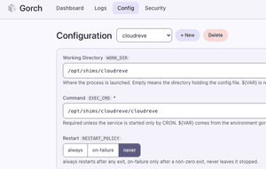

# gorch

Lightweight process supervisor written in Odin, inspired by [Sysg](https://github.com/ra0x3/systemg) and [Supervisor](http://supervisord.org/).

Single binary, no runtime dependencies. Declarative TOML config. Built-in Web UI.

[简体中文](./README-ZH.md)



## Why gorch?

- **Web UI + REST API** — Manage every service from a browser dashboard or script it against a small JSON API. The Odin build dropped the Go version's CLI subcommands; installing as a service is handled by two shell scripts.
- **TOTP 2FA for web login** — Account credentials are stored in the config file, but with TOTP two-factor authentication, even if the password leaks, your dashboard stays protected.
- **Single binary, zero dependencies** — One file, drop it anywhere and run.
- **Graceful reload support** — For Nginx/Angie-style daemons, `RESTART_CMD` keeps the master PID stable while reloading workers.

## When NOT to use gorch

gorch is great for web apps, API servers, cron jobs, and stateless daemons. It is **not recommended** for:

- **Traditional databases** (MySQL, PostgreSQL, etc.) — Frequent restarts can lead to data inconsistency or corruption. Use the database's own management tools instead.

## Binaries

Two binaries are built from this repo:

| Binary | What it does |
|--------|-------------|
| **gorch** | Process supervisor — manages long-running services and cron jobs, with a built-in Web UI and REST API |
| **weblite** | Lightweight static file server — serves a directory with directory listing, zero config |

Both are written in Odin. The Web UI is embedded into the `gorch` binary as gzip-compressed assets, so a single file is all you deploy; a `web/` directory next to the config still wins over the embedded copy.

## Install

### From Source

Requires [Odin](https://odin-lang.org/) `dev-2026-10` or newer; `make deps` fetches the one vendored submodule.

```sh
make deps        # fetch vendor/oboe
make one         # build ./bin/gorch for this machine
```

Release builds for macOS and Linux, arm64 and amd64 (macOS 11+; Linux binaries are static musl and need nothing on the target):

```sh
make build                                   # all four targets, plus bin/SHA256SUMS
make build TARGETS="linux_arm64"             # one target
make build CROSS_CC="x86_64-linux-musl-gcc"  # override the cross linker (default: zig cc)
```

Linux links the vendored minimal zlib in `third_party/zlib` (used for the state snapshot) into the static binary. A native build just uses the system zlib.

### Install as System Service

The Odin binary has no `install` subcommand. Two standalone scripts write the
systemd unit (Linux) or launchd plist (macOS) that runs gorch in the foreground
and keeps it alive:

```sh
sudo ./scripts/gorch-install --config /etc/gorch/gorch.toml   # system-wide
./scripts/gorch-install --user --config ~/.config/gorch/gorch.toml
sudo ./scripts/gorch-uninstall                                # remove the service
./scripts/gorch-uninstall --user
```

`gorch-uninstall` removes only the service file — the binary, config, logs and
state are kept. Use `--dry-run` to preview the generated unit/plist first, and
`--no-start` to write it without enabling. See the [CLI Reference](./docs/cli.md)
for all options and the files each script writes. On macOS,
[launchd-ui](https://github.com/azu/launchd-ui) is also handy for managing the
resulting agent.

## Quick Start

### 1. Create config

```sh
cp gorch.toml.example gorch.toml
```

Minimal config:

```toml
[services.myapp]
EXEC_CMD = "python app.py"
```

Real-world example:

```toml
LOG_DIR = '/tmp/gorch/logs'

[web]
WEB_ENABLE = true
WEB_AUTH = true
WEB_USER = "admin"
WEB_PASS = "secret"

[services.api]
EXEC_CMD = "python manage.py runserver 0.0.0.0:8000"
WORK_DIR = "/app/backend"
RESTART_POLICY = "on-failure"
BACK_OFF = 5
CHECK_PORT = 8000
STDOUT = "/tmp/gorch/logs/api.stdout.log"
STDERR = "/tmp/gorch/logs/api.stderr.log"
DEPENDS_ON = ["redis"]

[services.redis]
EXEC_CMD = "redis-server /etc/redis/redis.conf"
RESTART_POLICY = "always"
BACK_OFF = 3
```

### 2. Start gorch

```sh
gorch                          # foreground, config auto-detected
gorch -c /etc/gorch/gorch.toml # explicit config
```

There is no daemonize flag: gorch stays in the foreground and stops its children
on `SIGTERM`/`SIGINT`. To run it in the background, install it as a service with
`gorch-install` (above).

### 3. Check status

Open the Web UI dashboard, or query the API:

```sh
curl -u admin:secret http://127.0.0.1:8080/api/services
```

### 4. Control services

Use the dashboard's Start / Stop / Restart buttons, or the same API:

```sh
curl -u admin:secret -X POST http://127.0.0.1:8080/api/services/api/restart
curl -u admin:secret -X POST http://127.0.0.1:8080/api/services/api/stop
```

### 5. View logs

The Web UI has a live log viewer (stdout / stderr); the API returns a JSON tail:

```sh
curl -u admin:secret 'http://127.0.0.1:8080/api/services/api/logs?type=stderr&lines=100'
```

The `-u` credentials are only needed when `WEB_AUTH = true`. With
`URL_PREFIX = "/gorch"`, prepend the prefix to every API path.

### 6. Web UI

With `WEB_ENABLE = true`, open `http://127.0.0.1:8080` in your browser.

Features:
- Dashboard with real-time status
- Log viewer (stdout / stderr)
- Config editor with two-step save
- Cron validation

### 7. Serve static files with weblite

```sh
weblite -d ./public -p 8000
```

Serves the `./public` directory on port 8000 with auto-generated directory listings.

## Runtime Files

On startup gorch creates `/tmp/gorch` and its `logs/` subdirectory. Everything it
writes lives there unless you point `LOG_DIR` elsewhere:

| Path | Purpose |
|------|---------|
| `<LOG_DIR>/<name>.out.log` | Service stdout (default when `STDOUT` is unset) |
| `<LOG_DIR>/<name>.err.log` | Service stderr (default when `STDERR` is unset) |
| `<LOG_DIR>/gorch.state` | Atomic snapshot of service state (oboe cache) |

`LOG_DIR` defaults to `/tmp/gorch/logs`; with no `LOG_DIR` set, the state file is
`/tmp/gorch/gorch.state`. `STDOUT` / `STDERR` override individual log paths.

The Odin build has no Unix socket, supervisor PID file or CLI ↔ supervisor IPC —
service control goes through the Web UI and REST API. The global `PID_FILE` and
`SERVICES_LOCK` keys are still accepted for config compatibility but are unused.

> **Note:** `/tmp` is cleared on reboot (and periodically on macOS), so logs do not survive a restart. Point `LOG_DIR` at a persistent directory if you need to keep them.

## Documentation

- [Configuration](./docs/configuration.md) — all config fields, cron expressions, environment variables, service recipes
- [CLI Reference](./docs/cli.md) — binary flags, service scripts, and the REST API
- [Web UI](./docs/web-ui.md) — web interface features, sub-path deployment
- [TOTP 2FA](./docs/totp.md) — two-factor authentication setup, recommended apps
- [Architecture](./docs/architecture.md) — system design and tech stack

## License

MIT
