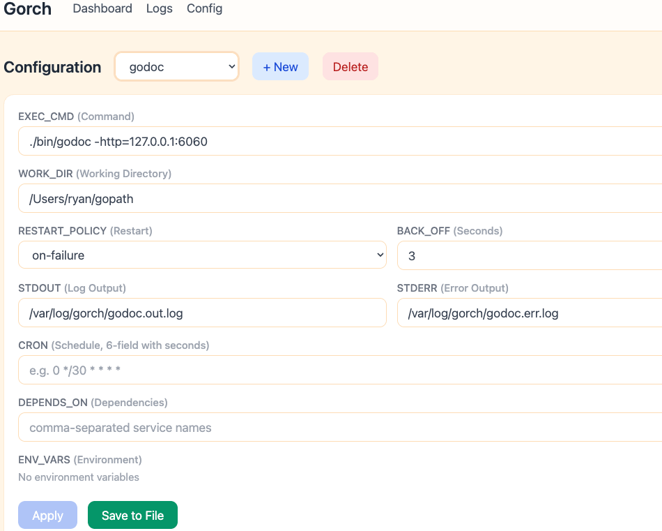

# gorch

Lightweight process supervisor written in Go, inspired by [Sysg](https://github.com/ra0x3/systemg) and [Supervisor](http://supervisord.org/).

Single binary, no runtime dependencies. Declarative TOML config. Built-in Web UI.

[简体中文](./README-ZH.md)



## Why gorch?

- **Dual interface** — Manage services from both the **CLI** and a **Web UI**, whichever you prefer. Simple and intuitive.
- **TOTP 2FA for web login** — Account credentials are stored in the config file, but with TOTP two-factor authentication, even if the password leaks, your dashboard stays protected.
- **Single binary, zero dependencies** — One file, drop it anywhere and run.
- **Graceful reload support** — For Nginx/Angie-style daemons, `RESTART_CMD` keeps the master PID stable while reloading workers.

## When NOT to use gorch

gorch is great for web apps, API servers, cron jobs, and stateless daemons. It is **not recommended** for:

- **Traditional databases** (MySQL, PostgreSQL, etc.) — Frequent restarts can lead to data inconsistency or corruption. Use the database's own management tools instead.

## Binaries

Three binaries are built from this repo:

| Binary | What it does |
|--------|-------------|
| **gorch** | Process supervisor — manages long-running services and cron jobs, with CLI **and** Web UI |
| **gorch-noweb** | Same supervisor built with `-tags noweb` — CLI only, no HTTP server and no embedded SPA |
| **weblite** | Lightweight static file server — serves a directory with directory listing, zero config |

Both `gorch` and `gorch-noweb` come from the same source (`./cmd/orchard`); `make noweb` builds the latter without touching the frontend.

## Install

### From Source

```sh
export PATH="$GOPATH/bin:$PATH"
go install github.com/azhai/gorch/cmd/orchard@latest
```

### Install as System Service

On macOS, [launchd-ui](https://github.com/azu/launchd-ui) is recommended for managing services.

```sh
gorch install            # system-wide (Linux: systemd, macOS: launchd)
gorch install --user     # user-level service
gorch uninstall          # remove
```

## Quick Start

### 1. Create config

```sh
cp gorch.toml.example gorch.toml
```

Minimal config:

```toml
[services.myapp]
EXEC_CMD = "python app.py"
```

Real-world example:

```toml
LOG_DIR = '/tmp/gorch/logs'

[web]
WEB_ENABLE = true
WEB_AUTH = true
WEB_USER = "admin"
WEB_PASS = "secret"

[services.api]
EXEC_CMD = "python manage.py runserver 0.0.0.0:8000"
WORK_DIR = "/app/backend"
RESTART_POLICY = "on-failure"
BACK_OFF = 5
CHECK_PORT = 8000
STDOUT = "/tmp/gorch/logs/api.stdout.log"
STDERR = "/tmp/gorch/logs/api.stderr.log"
DEPENDS_ON = ["redis"]

[services.redis]
EXEC_CMD = "redis-server /etc/redis/redis.conf"
RESTART_POLICY = "always"
BACK_OFF = 3
```

### 2. Start gorch

```sh
gorch start                    # foreground, default config
gorch start -c /etc/gorch.toml # specify config path
gorch start -d                 # daemonize (background)
```

### 3. Check status

```sh
gorch status
gorch status -s api            # single service
gorch status --json            # JSON output
gorch status -l                # live refresh
```

### 4. Control services

```sh
gorch restart -s api
gorch stop -s api
gorch stop                     # stop all
```

### 5. View logs

```sh
gorch logs -s api              # last 100 lines
gorch logs -s api -n 500      # last 500 lines
gorch logs -s api -f          # follow (tail -f)
```

### 6. Web UI

With `WEB_ENABLE = true`, open `http://127.0.0.1:8080` in your browser.

Features:
- Dashboard with real-time status
- Log viewer (stdout / stderr)
- Config editor with two-step save
- Cron validation

### 7. Serve static files with weblite

```sh
weblite -d ./public -p 8000
```

Serves the `./public` directory on port 8000 with auto-generated directory listings.

## Runtime Files

gorch keeps all of its own state in one directory, `/tmp/gorch`:

| Path | Purpose |
|------|---------|
| `/tmp/gorch/gorch.pid` | Supervisor PID file |
| `/tmp/gorch/gorch-services.lock` | PIDs of managed services (used to adopt processes across restarts) |
| `/tmp/gorch/gorch.sock` | Unix socket for CLI ↔ supervisor IPC |
| `/tmp/gorch/<name>.pid` | Per-service PID file |
| `/tmp/gorch/logs/<name>.out.log` | Service stdout (from `LOG_DIR`) |
| `/tmp/gorch/logs/<name>.err.log` | Service stderr (from `LOG_DIR`) |

Override them with the global `LOG_DIR`, `PID_FILE` and `SERVICES_LOCK` fields.

> **Note:** `/tmp` is cleared on reboot (and periodically on macOS), so logs do not survive a restart. Point `LOG_DIR` at a persistent directory if you need to keep them.

## Documentation

- [Configuration](./docs/configuration.md) — all config fields, cron expressions, environment variables, service recipes
- [CLI Reference](./docs/cli.md) — all commands and flags
- [Web UI](./docs/web-ui.md) — web interface features, sub-path deployment
- [TOTP 2FA](./docs/totp.md) — two-factor authentication setup, recommended apps
- [Architecture](./docs/architecture.md) — system design and tech stack

## License

MIT
